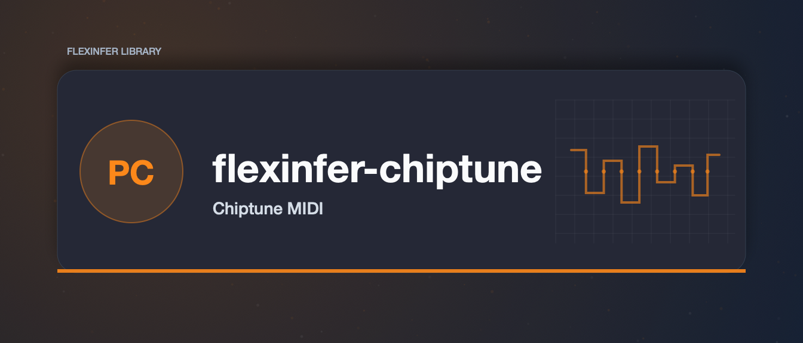

# flexinfer-chiptune

A Python library for generating 8-bit/16-bit style MIDI music and sound effects with a semantic API that agents can use to programmatically compose music.

## Features

- **Music Theory Foundation**: Scales, chords, arpeggios with emotion-to-music mapping
- **Game Theme Templates**: Pre-built patterns for battle, boss, victory, overworld, etc.
- **NES Constraints**: Authentic 4-channel (2 pulse, triangle, noise) sound chip model
- **Jingle Generator**: Quick musical phrases for game events
- **Sound Effects**: Common game SFX (coin collect, jump, explosion, etc.)
- **Agent-Friendly API**: Natural language context → music generation
- **MIDI Export**: Standard MIDI files playable in any DAW

## Installation

```bash
pip install flexinfer-chiptune
```

Or with uv:

```bash
uv add flexinfer-chiptune
```

## Quick Start

### Using the Composer API

```python
from chiptune import ChiptuneComposer

# Create a heroic battle theme
composer = (
    ChiptuneComposer.create(bpm=150, root="A", mode="minor")
    .set_theme("battle")
    .add_melody(contour="ascending", length_bars=8)
    .add_bass(style="octave")
    .add_arpeggio_layer()
    .add_drums(pattern="driving")
)

# Export to MIDI
composer.export_midi("battle_theme.mid")
```

### Using the Agent API

```python
from chiptune import MusicAgent

agent = MusicAgent()

# Generate music from natural language context
music = agent.compose_for_context(
    context="player enters the boss arena",
    duration_seconds=30.0,
    intensity=0.9,
)

# Generate a sound effect
sfx = agent.generate_sfx("coin_collect")
```

### Using Jingles

```python
from chiptune import Jingle

# Create quick jingles
victory = Jingle.victory_fanfare(root="C", tempo=140)
item = Jingle.item_get(root="G")
level_up = Jingle.level_up()
```

### Using Sound Effects

```python
from chiptune import SFXGenerator

sfx = SFXGenerator()

# Generate common game sounds
coin = sfx.coin_collect()
jump = sfx.jump()
explosion = sfx.explosion()
powerup = sfx.powerup()

# Save to file
sfx.save(coin, "coin.mid")
```

## Semantic Mappings

### Emotions → Musical Elements

| Emotion | Scale/Mode | Tempo | Character |
|---------|------------|-------|-----------|
| Heroic | Major/Lydian | Fast | Driving, 4ths/5ths |
| Mysterious | Dorian | Medium | Syncopated |
| Danger | Phrygian/Locrian | Fast | Urgent, chromatic |
| Peaceful | Pentatonic | Slow | Flowing, 3rds/6ths |
| Sad | Minor/Aeolian | Slow | Simple, minor 3rds |

### Game Contexts → Themes

| Context | Characteristics |
|---------|-----------------|
| Battle | Fast, minor, syncopated, driving drums |
| Boss | Epic, chromatic, heavy bass, intense |
| Victory | Major fanfare, I-IV-V-I, triumphant |
| Overworld | Adventurous, major, walking bass |
| Dungeon | Modal, sparse, atmospheric |
| Shop | Relaxed, major, simple rhythm |

## API Reference

### ChiptuneComposer

Main entry point for composing music:

- `create(bpm, root, mode)` - Create a new composer
- `set_mood(mood)` - Configure for emotional character
- `set_theme(theme)` - Configure for game context
- `add_melody(contour, length_bars)` - Generate melody
- `add_bass(style)` - Add bass line
- `add_drums(pattern)` - Add percussion
- `add_arpeggio_layer()` - Add harmony arpeggios
- `export_midi(path)` - Export to MIDI file
- `to_midi_bytes()` - Get MIDI as bytes

### MusicAgent

Semantic interface for AI agents:

- `compose_for_context(context, duration, intensity)` - Generate from description
- `generate_sfx(event)` - Generate sound effect
- `compose_loop(mood, bars)` - Generate loopable segment

### Jingle

Quick musical phrases:

- `victory_fanfare()` - Triumphant victory sound
- `item_get()` - Item pickup jingle
- `level_up()` - Level up fanfare
- `coin_collect()` - Quick coin sound
- `game_over()` - Sad game over jingle

### SFXGenerator

Game sound effects:

- `coin_collect()` - Coin pickup
- `jump()` - Jump sound
- `land()` - Landing thud
- `explosion()` - Explosion
- `damage()` - Hurt/damage
- `powerup()` - Power-up sound
- `menu_select()` - Menu cursor
- `menu_confirm()` - Menu confirmation
- `laser()` - Projectile/laser
- `teleport()` - Teleport sound

## Development

```bash
# Clone the repository
git clone https://gitlab.flexinfer.ai/libs/py-chiptune.git
cd py-chiptune

# Install dependencies
uv sync

# Run tests
uv run pytest

# Run the demo
uv run python examples/demo.py
```

## License

MIT License
